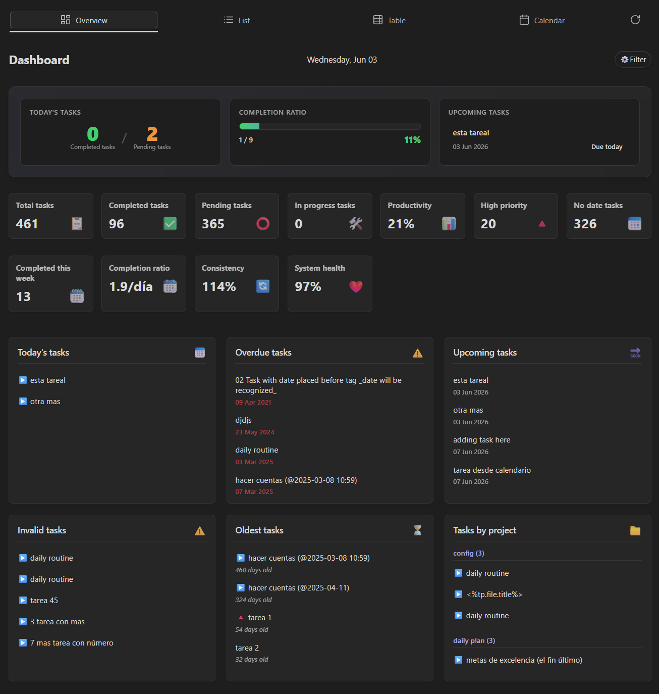
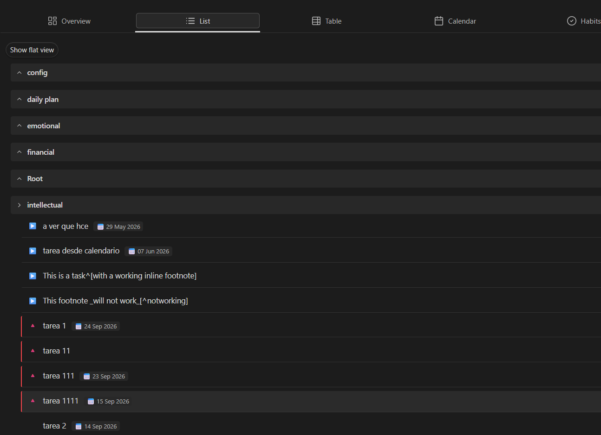
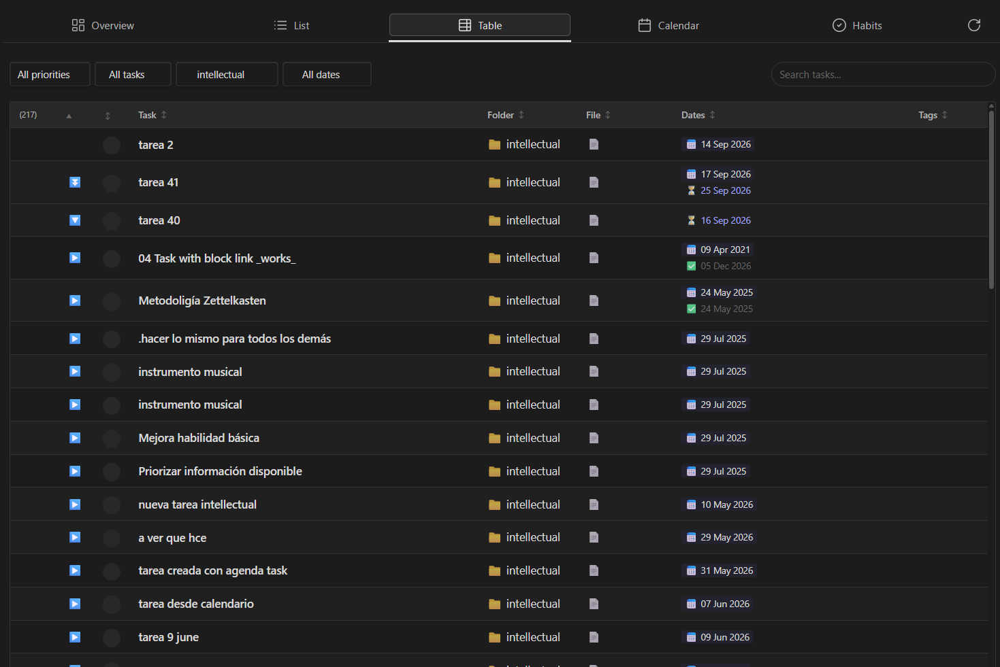
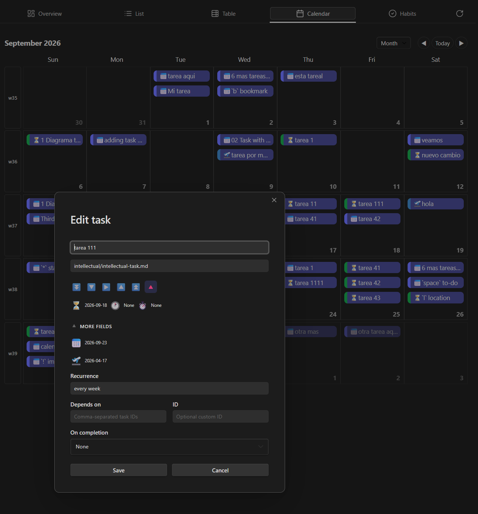
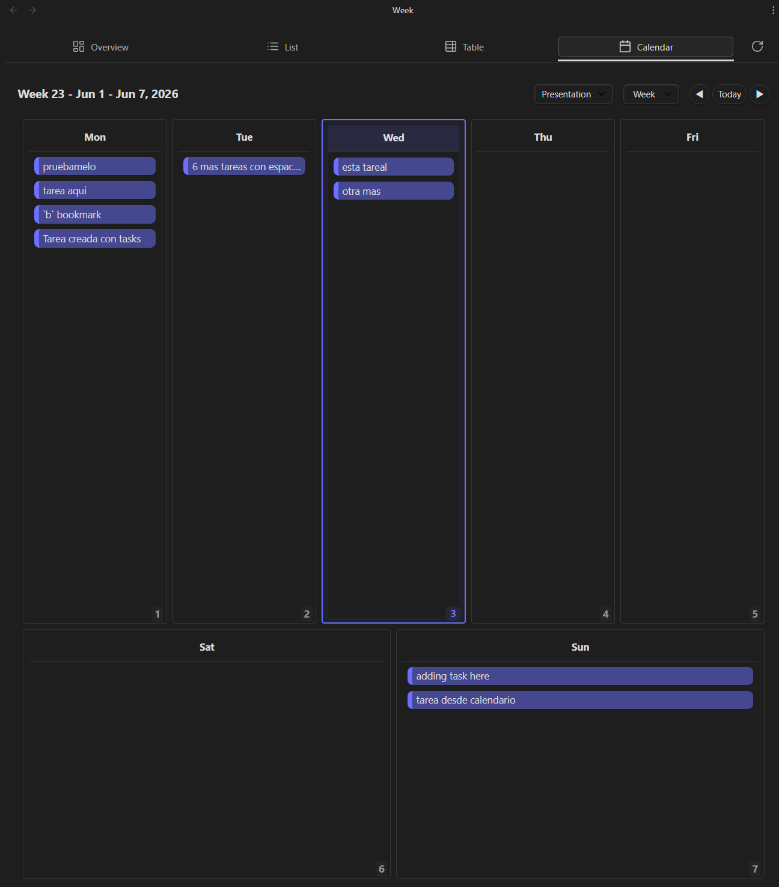
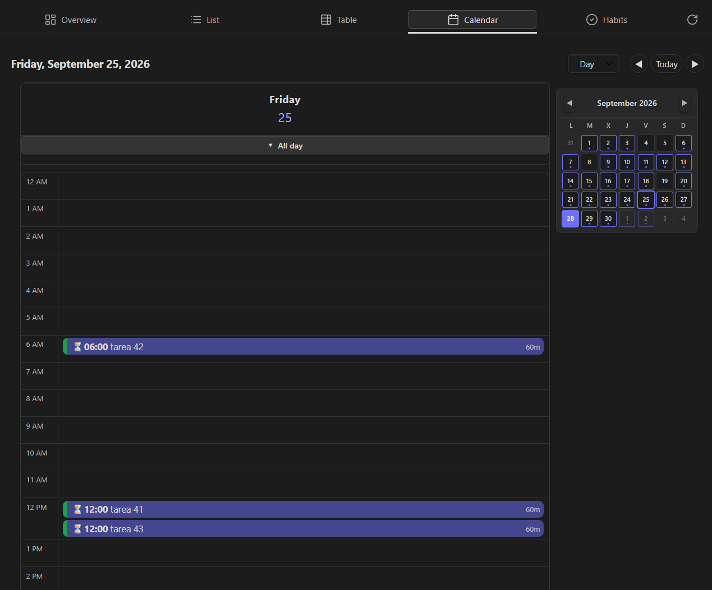
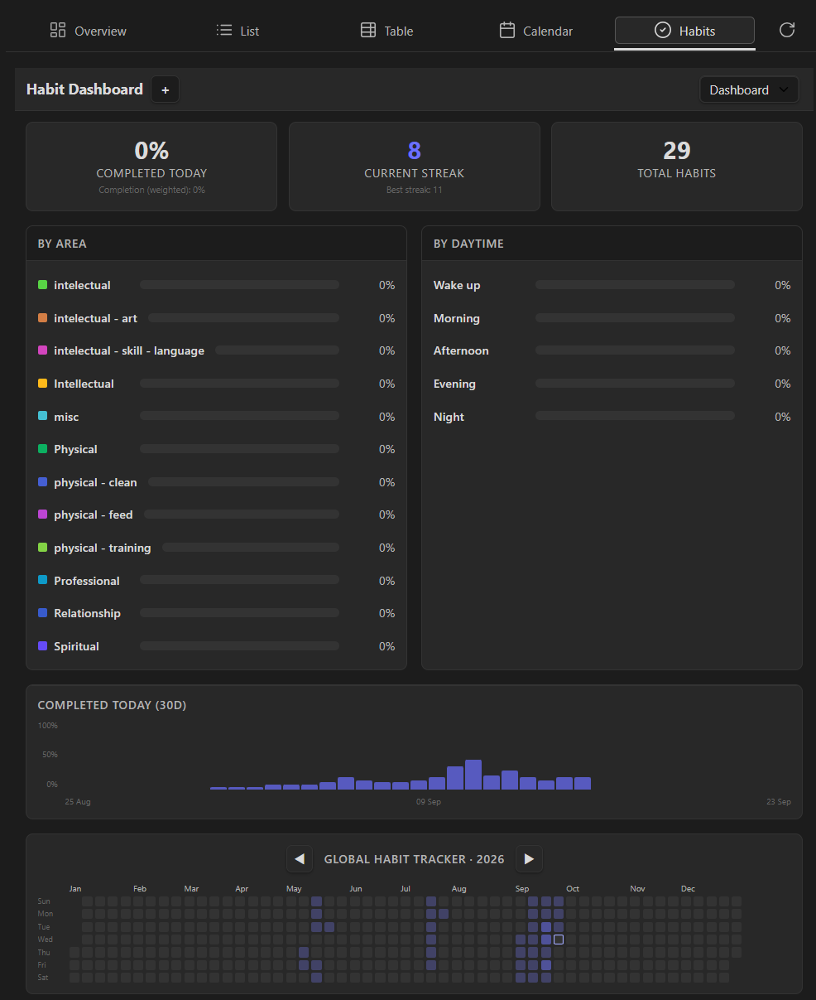
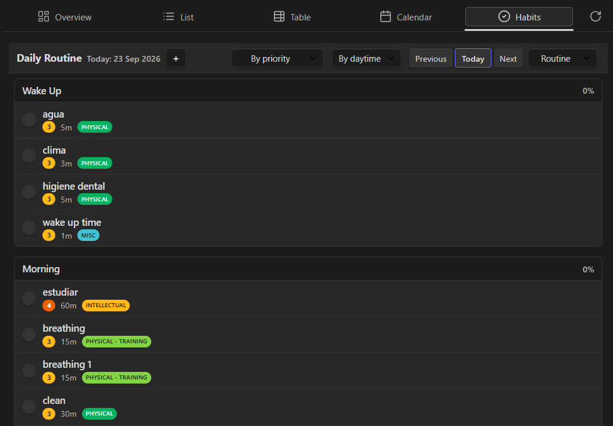
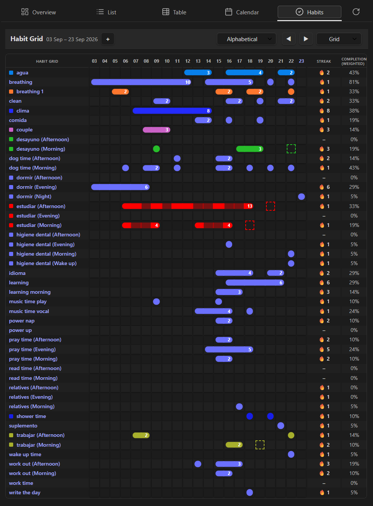
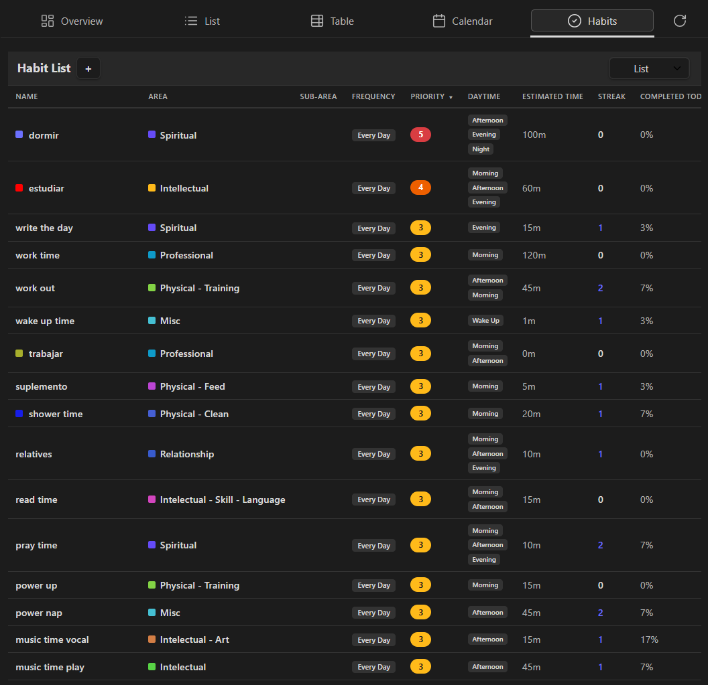

# 📅 Agenda Tasks

> A comprehensive task management and calendar plugin for Obsidian

[](https://github.com/elias-shalom/obsidian-agenda/releases)
[](LICENSE)
[](https://obsidian.md)

> 🆕 **What's New in v1.1.13** — two new tabs: a **Kanban** board (drag cards to change a task's status or priority) and a **Gantt** chart (move bars and drag their edges to change dates), a window that tells you what's new after an update, simpler tab settings (one **Tasks** switch and a **Habits** switch), a **Root** option in the Area and Sub-area filters, a safer habits folder, and the right weekday names in the Week, Work Week and List calendar views. [See details](#news) · [Full changelog](#changelog).

## Overview

Agenda Tasks transforms your Obsidian vault into a powerful productivity system by providing intuitive task management interfaces and multiple calendar views. Seamlessly integrate with your existing Obsidian notes while organizing tasks across multiple views for maximum efficiency.

**Key Benefits:**
- 🎯 Multiple view types tailored to different workflows
- 🔄 Real-time synchronization with your notes
- 🏗️ Compatible with Obsidian Tasks plugin
- 🌐 Support for 6+ languages
- ⚙️ Highly customizable interface

---

## 📖 Table of Contents

- [News](#news)
- [Features](#features)
- [Screenshots](#screenshots)
- [Installation](#installation)
- [Quick Start](#quick-start)
- [User Manual](docs/user_guide/README.md) ([English](docs/user_guide/en/00-introduction.md) · [Español](docs/user_guide/es/00-introduction.md))
- [Gestures & Interactions](#gestures--interactions)
- [Task Format](#task-format-and-compatibility)
- [Configuration](#configuration)
- [Changelog](#changelog)
- [Planned Features](#planned-for-future-versions)
- [Support](#support-and-feedback)
- [Contributing](#contributing)

---

## 🆕 News

### v1.1.13 (latest)
- **Kanban tab**: your tasks as a board. Columns by **Status** (default), **Priority**, **Tags** or **Folder**, with the shared filter bar (search, filters, sort) and its own remembered settings. Drag a card to another status column to change its status (moving it to Done adds ✅ and completing a recurring task creates its next occurrence) or to another priority column to change its priority. Click edits, double-click opens the note and right-click changes the status
- **Collapsible columns**: click a column header to fold it into a thin bar with its name and task count (empty columns start folded). A folded column still accepts a dropped card and opens by itself; tall columns scroll on their own with a fixed header
- **Gantt tab**: one row per task on a time axis, grouped by area and sub-area. Zoom to 7, 14 or 21 days or a calendar month, with month tabs, year arrows, week bands, a thin vertical day grid with weekends shaded and a line for today. A task with two or more of 🛫, ⏳ and 📅 is a bar, one with a single date is a milestone, and the rest wait in a collapsible "Tasks without a date" group below. Hover a bar to see all its dates; 🔗 marks tasks with dependencies. Status and priority show next to each name
- **Edit dates from the Gantt**: drag a bar to move all its dates, drag an edge to rewrite only the field that edge shows (start, scheduled or due), or stretch a milestone into a bar. A tooltip shows what will be written, a bar can never end before it starts, and the 🆔/⛔ links and the creation and done dates are left alone
- **Simpler tab settings**: one **Show Tasks tab** switch replaces the List and Table ones, **Show Habits tab** hides the whole Habits tab, and there are new **Show Kanban tab** and **Show Gantt tab** switches
- **What's new window**: after an update, a window shows the news once, translated to your language (turn it off in Settings ▸ Show what's new after an update)
- **Habits folder**: if the folder does not exist, creating your first habit offers to create it (with an editable path), Settings tells you whether it exists, and every habit view shows a clear message instead of an error when there are no habits
- **Filters and labels**: the Area filter has a **Root** option for notes outside any folder and the Sub-area filter has one for notes directly in an area's folder. Group and sort selectors now read "Group:" and "Sort:", and the habit sort options lost their "By" prefix
- **Fix**: the Week, Work Week and List calendar views showed shifted weekday names when the week did not start on Sunday. Thanks to [@AidanAJoyce](https://github.com/AidanAJoyce) ([#58](https://github.com/elias-shalom/obsidian-agenda/pull/58))
- The README now links to the user manual, in English and Spanish

### v1.1.12
- **One "Tasks" tab**: the List and Table views share a tab with a **List | Table** switch. Search, filters, grouping and sort order are shared and remembered, so switching mode (or coming back from editing a task) keeps what you were looking at
- **Areas and sub-areas**: a task's area is the first folder of its note and its sub-area is the rest of the folder path (any depth); notes in the vault root are "No area". Use them to filter and to group (nested sub-areas, colored group headers); tasks sitting directly in an area's folder are listed last under "No sub-area"
- **New filter bar**: a **+ Filter** button opens step-by-step menus (type, then value) for Priority, Status, Area (with sub-area), Start, Scheduled and Due. Active filters appear as removable chips with a **Clear** button; search sits on the right and drops to its own line on narrow windows
- **Grouping** in List and Table: No grouping, Area and sub-area, Folder (flat), Status, Priority, Tags or Due date, with collapsible groups. This replaces the old hierarchical/flat button
- **Table dates**: the single Dates column became four — **Start** (with the creation date below), **Scheduled** (with time and duration), **Due** and **Closed** (done or cancelled). A date column is hidden when no loaded task has that date. The Folder column is now **Area**, row numbers are gone and columns fit the available width, even on phones and tablets
- **Date filters per type**: Due, Start and Scheduled each filter by With date, Overdue/Past, Today, Next 7 days, Future or No date. "Overdue" now counts only open tasks, and sorting works on all four date columns (also in the List)
- **List**: each task shows its start (🛫), scheduled (⏳, with time) and due (📅) dates, and right-clicking a task in the List or Table opens the status menu, like in the calendar
- **Automatic refresh**: List, Table, Calendar and Habit views update on their own about half a second after a real change in your notes (saving a note without touching tasks does nothing), keeping scroll, filters and collapsed groups, and waiting while a modal, menu, drag or text field is in use. At midnight the views switch to the new day without any interaction
- **Safer edits**: before changing a task line the plugin checks it still matches what the view showed; if the note changed in the meantime it finds the exact line or cancels with a notice instead of editing another task

### v1.1.11
- **Android phone and tablet layout fixes**: Obsidian's mobile styles were distorting several controls. Fixed the calendar view-type buttons (their icons were invisible), the date picker (clipped on the right), the Day view sidebar toggle, the Habit Routine completion circle (oval), Habit Grid and Weekly cells (rectangular cells, shifted and cut streak pills), and buttons in the Task Modal, the Habit Editor and the Table
- **Habit Routine** on narrow screens: habit names are visible again, long area tags no longer overflow their pill, and clicking a habit name opens the Habit Editor (double-click opens its note), like Grid, Weekly and List; the hover-only action buttons are hidden on touch devices
- **Dark themes**: header tab labels and icons are readable without hovering
- **Calendar List view**: each row shows the month abbreviation, so a window that crosses a month boundary stays clear
- **Table**: the File column was removed, and the row-number and date columns are narrower to reduce horizontal scrolling
- The List view descriptions in this README and the user guide now match what the view does
- Updated dependencies (including a security fix in Handlebars) and fixed new lint findings

### v1.1.10
- New **List view** inside the calendar: one row per day in a continuous, configurable 7–14 day window (default 14, Settings ▸ Calendar), reusing the same task pills as Month/Week — no "N more" collapsing
- **Day view** now supports a 1/3/5-day mode, with the reference day centered and its own hour grid, duration blocks and lanes per column; dragging a task to another column reschedules it to that day
- **Task status management from the calendar**: a new "On Hold" status, a status icon on every calendar task pill, and a right-click context menu (or a Task Modal field) to change a task's status — marking "Done" adds the completion date, same as the native checkbox
- **Recurring tasks (🔁)**: completing a recurring task now inserts its next occurrence right above, computed with the `rrule` library and respecting `when done`
- **Unified date picker** in the Task Modal: the due/start/scheduled fields now open the same calendar popover used across calendar views, with a dot marking days that already have tasks
- **Duration modal** now uses a circular time dial (shared with the Habit Editor) instead of a plain number input, up to 7 hours in 5-minute steps
- Recurrence field in the Task Modal now offers autocomplete with recognized patterns (including `when done` variants)
- Fixed: `task-filter.ts` compared a task's status symbol against status text, so completed/cancelled tasks were never excluded as expected

### v1.1.9
- Day view now renders tasks with their real duration: connected blocks for 60+ minute tasks, half-cell blocks for shorter ones, and side-by-side lanes so overlapping tasks never cover each other
- Resize a task's duration directly from the Day view by dragging its bottom edge, snapping to 30-minute steps
- Dragging a task to a new time slot in the Day view now snaps to the exact half-hour under the pointer
- A shared reference date is kept when switching between calendar view types, with a new date picker (popover in Month/Week/Work Week/Year, always visible in Day) to jump to any date
- The calendar view-type switcher is now a compact row of icon buttons instead of a dropdown
- Double-click to create a task directly in the Day view's hour grid or "All day" section
- Click a day cell in Month/Week/Work Week/Year to select and highlight it as the reference date, without interfering with the double-click-to-create gesture
- Fixed the Work Week view's task click gesture to match the rest of the calendar (click edits, double-click opens the note)

### v1.1.8
- Refreshed the List view with compact task rows, clearer folder hierarchy, priority cues, and improved selection feedback
- Refreshed the Table view with clearer filters, denser rows, visible status/priority cues, and compact date/tag styling
- Table search, filters and sort order are remembered when returning from task editing or switching views; column widths adapt to the filtered rows
- Sortable Table headers support mouse and keyboard interaction
- Added consistent themed tooltips across plugin views and task modals, with clearer Dashboard metric/list descriptions in all six supported languages

### v1.1.7 
- Fixed Habit Tracker startup after plugin updates: views wait for the initial habit cache to finish loading after saved settings are available
- Fixed habit edits that could duplicate the YAML frontmatter block; the editor now performs one write and normalizes affected notes when they are edited again
- Dashboard area/daytime percentages now count completed occurrences individually, so a completed morning occurrence counts while an afternoon occurrence remains pending
- Grid and Weekly show a consistent daytime badge beside every multi-daytime row; a setting (on by default) controls the badge for single-daytime habits
- Grid and Weekly remember their last selected sort order; the Habit List status column is sortable
- Routine groups can be collapsed independently, and each group's collapsed state is remembered
- Habit names use consistent gestures: single-click opens the Habit Editor and double-click opens the note in Grid, Weekly and List
- Known area names such as `daily plan` are normalized to their palette key (`daily-plan`) when resolving area colors

### v1.1.6 
- Fixed habit edits that could duplicate the YAML frontmatter block; the editor now performs one atomic write and normalizes affected notes when they are edited again
- Habit Grid, Weekly and List views now use consistent gestures: single click opens the Habit Editor and double-click opens the habit note

### v1.1.5
- Fixed a race condition where editing a habit could save the file correctly but leave old values in the Habit Tracker views until a later refresh. The cache now parses frontmatter from the file content it just read.

### v1.1.4
- **Time-of-day scheduling**: the ⏳ `scheduled` date can now carry a 🕐 time and, for block-mode tasks, a ⏱️ duration — fully optional and additive, existing tasks are unaffected. `due` stays a whole-day field
- **Insert or edit task fields from the editor**, no need to open a modal: a right-click context menu and a command (with keyboard shortcut) work on any task line, using a native date picker and a new iOS-style scroll wheel for the time
- **Calendar views** (Month/Week/Work Week/Day) can now show `start` and `scheduled` dates alongside `due`, each with its own icon + color badge — configurable in Settings ▸ Calendar; completed tasks are dimmed by default, with an option to hide them entirely
- **Day view** now has a real hourly grid populated from scheduled times, plus a collapsible "All day" section for `due`/`start`
- **Drag and drop** a task in any calendar view to reschedule it: drag to another day in Month/Week/Work Week, or to another hour in Day view
- **Click a task in the calendar to edit it** in a prefilled modal — double-click still opens the underlying note
- **Task creation modal redesigned**: scheduled date is now the default field, priority is a one-click segmented selector, and a collapsible "More fields" section holds start date, due date, recurrence, dependencies, on-completion behavior and a custom ID

See the [full changelog](#changelog) below for older versions.

---

## ✨ Features

### 📊 Available Views

#### Overview View
- Dashboard-style task summary with key metrics
- Statistics and progress tracking
- Quick access to upcoming deadlines
- Task distribution by project/folder
- Overdue task highlighting
- Customizable widgets

#### List View
- Compact task rows with priority cues, plus start, scheduled and due dates when a task has them
- Shares the **Tasks** tab with the Table view (List | Table switch)
- Search, filter chips (Priority, Status, Area, Start, Scheduled, Due), grouping and sort order
- Group by area and sub-area (nested), folder, status, priority, tags or due date; collapsible groups
- Click a task to edit it in the task modal; double-click to open its note; right-click to change its status

#### Table View
- Spreadsheet-style task management, in the same **Tasks** tab and with the same filter bar as the List view
- Start, Scheduled, Due and Closed date columns (hidden when no task has that date)
- Sortable and resizable columns that fit the available width
- Grouping with collapsible group headers
- Quick entry and editing of task attributes
- Conditional formatting

#### Calendar View
- Multiple calendar layouts (day, week, work week, month, year, and list)
- Day view supports a 1/3/5-day mode with the reference day centered
- List view shows a continuous, configurable 7–14 day window, one row per day
- Task visualization on calendar grid
- Mini-calendar for quick date navigation
- Task indicators showing busy days
- Quick task creation at specific times
- Syncs with native Obsidian daily notes

#### Kanban View (new in 1.1.13)
- Board of real tasks: moving a card rewrites the task line in its note
- Columns by status (default), priority, tags or folder; the same search, filters and sort order as the Tasks tab, saved separately
- Drag a card to another status column to change its status, or to another priority column to change its priority (tags and folders are read-only)
- Collapsible columns that remember your choice, with empty ones folded by default
- Click a card to edit it, double-click to open its note, right-click to change its status

#### Gantt View (new in 1.1.13)
- One row per task on a time axis, grouped by area and sub-area (collapsible), with a vertical day grid and weekends shaded
- Zoom 7, 14 or 21 days or a calendar month; month tabs, year arrows and a line for today
- Bars from start to due (with a notch for the scheduled date), milestones for tasks with a single date, and a collapsible list of tasks without a date
- Move bars, drag their edges to change a single date, or stretch a milestone into a bar; a tooltip shows exactly what will be written
- Same search, filters and gestures as the other task views

#### Habit Tracker (new in 1.1.0)
- **Habit Grid** - GitHub-style day-by-day grid with a merged streak "pill", per-occurrence rows for multi-daytime habits, and a configurable sort order
- **Daily Routine** - Today's habits grouped by daytime or by area (toggle), with weighted progress bars and quick actions to open the note or edit the habit
- **Habit Dashboard** - Today's raw/weighted completion, current and best streaks, side-by-side breakdowns by area and daytime, a 30-day history chart, and a GitHub-style yearly heatmap you can navigate by year (this is now the default habit view)
- **Weekly view** - 7-day matrix sharing the same visual language as the Grid (pills, circles, sorting)
- **Habit Table/List** - Sortable catalog of all habits with area, related-file link, frequency, priority, daytime, time and streak columns
- **Habit Creator** - A modal to create and edit habits: a circular time dial, priority/max-gap sliders, an active/inactive switch, and an area combobox suggested from your vault's root folders (free-form, not a fixed list)

### 🔧 General Capabilities
- ✅ Parse and track tasks from your entire vault
- ✅ Compatible with [Obsidian Tasks](https://github.com/obsidian-tasks-group/obsidian-tasks) syntax
- ✅ Real-time task updates, with views that refresh by themselves
- ✅ Areas and sub-areas derived from your folder structure
- ✅ Kanban board and Gantt chart that edit your tasks in place
- ✅ A "what's new" window after each update, in your language
- ✅ Built-in Habit Tracker module (Grid, Routine, Dashboard, Weekly and Table views, plus a habit creator/editor)
- ✅ Customizable interface with themes support
- ✅ Keyboard shortcuts for common actions
- ✅ 6+ language support (English, Spanish, German, Portuguese, French, Italian)
---

## 📸 Screenshots

| View | Screenshot |
|------|-----------|
| **Overview Dashboard** |  |
| **List View** |  |
| **Table View** |  |
| **Month Calendar** |  |
| **Week Calendar** |  |
| **Day View** |  |

---

| View | Screenshot |
|------|-----------|
| **Habit Dashboard** |  |
| **Daily Routine** |  |
| **Habit Grid** |  |
| **Habit List** |  |

---

## 📥 Installation

### From Obsidian Community Plugins (Recommended)
1. Open **Obsidian Settings**
2. Navigate to **Community Plugins** and disable **Safe Mode**
3. Click **Browse** and search for **"Agenda"**
4. Click **Install** and then **Enable**

### Manual Installation
1. Download the latest release from the [releases page](https://github.com/elias-shalom/obsidian-agenda/releases)
2. Extract the zip file to your vault's `.obsidian/plugins/obsidian-agenda/` folder
3. Verify the following files are present:
   - `main.js`
   - `styles.css`
   - `manifest.json`
4. Enable the plugin in **Obsidian Settings → Community Plugins**

**Requirements:**
- Obsidian v0.13.0 or higher
- No additional dependencies required

---

## 🚀 Quick Start

### Creating Your First Agenda View
1. Click the **Agenda icon** in the left sidebar ribbon
2. Select your preferred view type:
   - **Overview** - Dashboard with key metrics
   - **List / Table** - One "Tasks" tab with a List | Table switch
   - **Calendar** - Calendar visualization
3. Your tasks will automatically populate from your vault

### Common Actions
- **Filter tasks** - Click **+ Filter** (List and Table views) and pick a type and a value
- **Create task** - Use Ctrl+P or the create button
- **Edit task** - Click any task to edit inline or in modal
- **Sort tasks** - Use the sort selector, or click column headers (Table view)

For step-by-step guides, read the **User Manual** ([English](docs/user_guide/en/00-introduction.md) · [Español](docs/user_guide/es/00-introduction.md)) or visit the [Wiki](https://github.com/elias-shalom/obsidian-agenda/wiki).

---

## 🖱️ Gestures & Interactions

A quick reference of clicks, double-clicks and drags across the plugin — handy while you're getting familiar with it.

### 📅 Calendar Views (Day / Week / Work Week / Month / Year / List)

| Gesture | Where | Result |
|---|---|---|
| Click | A task pill | Opens the **Edit Task** modal, prefilled with that task's data |
| Double-click | A task pill | Opens the underlying note, cursor on that line |
| Right-click | A task pill | Opens a context menu to change the task's status |
| Click | A view-type icon button (header) | Switches to that calendar view (Day/Week/Work Week/Month/Year/List), keeping the current reference date |
| Click | A day cell/row (Month/Week/Work Week/Year/List) | Selects and highlights that date as the shared reference date |
| Click | A day number (Month/Week/Work Week/Year/List) | Jumps to the **Day view** for that date |
| Double-click | Empty space in a day cell/row | Opens **Create Task** prefilled with that date |
| Click | The date picker trigger (header, Month/Week/Work Week/Year/Day/List) | Opens a popover to jump to any day, month or year |
| Click | A date in the date picker (popover or Day view sidebar) | Jumps to that date, updating the shared reference date |
| Click | The 1/3/5 day-count buttons (Day view) | Shows that many day columns at once, centered on the reference day |
| Drag | A task pill to another day/column (Month/Week/Work Week/Day 3-5 mode) | Reschedules the task to that day (moves whichever date anchors it: `scheduled` > `due` > `start`) |
| Drag | A task pill to another hour slot (Day view) | Changes the task's scheduled time, snapping to the exact half-hour (`:00`/`:30`) under the pointer |
| Drag | The bottom edge of a task block (Day view) | Resizes the task's duration in 30-minute steps (30-minute minimum) |
| Double-click | Empty space in an hour slot or the "All day" section (Day view) | Opens **Create Task** prefilled with that date/time |
| Click | The "All day" section header (Day view) | Expands/collapses the due/start section |
| Click | The sidebar collapse handle (Day view) | Collapses/expands the mini-calendar sidebar |
| Click | ◀ / ▶ (List view) | Moves the whole displayed window by its configured number of days |

### 📋 List, Table & Overview

| Gesture | Where | Result |
|---|---|---|
| Click | A task row/item (List or Table view) | Opens the **Edit Task** modal, prefilled with that task's data |
| Double-click | A task row/item | Opens the underlying note, cursor on that line |
| Right-click | A task row/item (List or Table view) | Opens a context menu to change the task's status |
| Click | **List \| Table** switch (Tasks tab) | Switches mode, keeping search, filters, grouping and sort order |
| Click | **+ Filter** (List or Table view) | Opens menus to pick a filter type and value (Area asks for a sub-area too) |
| Click | A filter chip's ×, or **Clear** | Removes that filter, or all of them (search is not cleared) |
| Click | A group header (List or Table view) | Collapses or expands that group; its state is remembered |
| Click | A column header (Table view) | Sorts by that column; click again to reverse. Sorting is also keyboard-accessible with Enter or Space |
| Hover or keyboard focus | A control or widget with a tooltip | Shows a themed tooltip with its explanatory text |

Search, filters, grouping and sort order are shared by the List and Table views and remembered when you return from editing a task or switch views. Column widths adapt to the rows visible after filtering.

### 🗂️ Kanban

| Gesture | Where | Result |
|---|---|---|
| Click | A card | Opens the **Edit Task** modal, prefilled with that task's data |
| Double-click | A card | Opens the underlying note, cursor on that line |
| Right-click | A card | Opens a context menu to change the task's status |
| Drag | A card to another column (grouped by status) | Changes the task's status; Done adds ✅ and a recurring task creates its next occurrence |
| Drag | A card to another column (grouped by priority) | Changes the task's priority; the Normal column removes the priority icon |
| Click | A column header | Folds the column into a thin bar, or opens it again; your choice is remembered |
| Drop | A card on a folded column | Moves the task there and opens the column |

### 📊 Gantt

| Gesture | Where | Result |
|---|---|---|
| Drag | A bar or milestone | Moves all of its dates by whole days |
| Drag | The left or right edge of a bar | Rewrites only the field that edge shows (start, scheduled or due); the end never goes before the start |
| Drag | The handle beside a milestone | Stretches it into a bar, creating the next date (start → scheduled → due; a due-only milestone creates a start date) |
| Hover | A bar or milestone | Shows all of the task's dates |
| Click / double-click / right-click | A row | Opens the **Edit Task** modal, opens the note, or opens the status menu |
| Click | A group header | Collapses or expands the group; its state is remembered |
| Click | A zoom button, ◀ / ▶, **Today**, a month tab or the year arrows | Changes the zoom or moves the window |
| Click | "Tasks without a date" | Shows or hides that list (collapsed by default) |

### 🔥 Habit Tracker

| Gesture | Where | Result |
|---|---|---|
| Click | A grid cell or a routine checkbox | Toggles the habit as done/not done for that day (updates instantly, then confirms the write) |
| Click | A group header (Routine view) | Collapses or expands that group; its state is remembered |
| Click | A habit's name (Grid/Weekly view) | Opens the **Habit Editor** |
| Double-click | A habit's name (Grid/Weekly view) | Opens the habit's underlying note |
| Click | A habit row (List/Table view) | Opens the **Habit Editor** |
| Double-click | A habit row (List/Table view) | Opens the habit's underlying note |
| Click | "Open note" action (Routine view) | Opens the habit's own note |
| Click | "Open related file" action (Routine/Table view) | Opens the file linked in the habit's related-files field |
| Click | A column header (Table view) | Sorts by that column |

---

## 📝 Task Format and Compatibility

Agenda Tasks works seamlessly with tasks created using the standard Obsidian checkbox format (`- [ ]`) and is fully compatible with the popular [Obsidian Tasks plugin](https://github.com/obsidian-tasks-group/obsidian-tasks).

### Supported Metadata

The plugin recognizes and properly handles all standard Obsidian Tasks metadata, plus its own time-of-day extensions (v1.1.4):

| Metadata | Icon | Example | Notes |
|----------|------|---------|-------|
| Due Date | 📅 | `- [ ] Task 📅 2024-12-31` | Always a whole day |
| Scheduled Date | ⏳ | `- [ ] Task ⏳ 2024-06-15` | Only date that can carry a time/duration |
| Scheduled Time | 🕐 | `- [ ] Task ⏳ 2024-06-15 🕐 14:30` | Optional, 24h `HH:mm`; requires a scheduled date |
| Duration | ⏱️ | `- [ ] Task ⏳ 2024-06-15 🕐 14:30 ⏱️ 90m` | Optional, minutes; requires a scheduled time (block mode) |
| Start Date | 🛫 | `- [ ] Task 🛫 2024-06-01` | Always a whole day |
| Priority | ⏬🔽🔼⏫🔺 | `- [ ] Task ⏫` | Lowest/Low/(Normal, no icon)/Medium/High/Highest |
| Recurrence | 🔁 | `- [ ] Task 🔁 every day` | Natural-language recurrence |
| Depends on | ⛔ | `- [ ] Task ⛔ abc123,def456` | Comma-separated task IDs |
| On completion | 🏁 | `- [ ] Task 🏁 delete` | `keep` or `delete` |
| ID | 🆔 | `- [ ] Task 🆔 abc123` | Referenced by `⛔` on other tasks |
| Tags | `#tag` | `- [ ] Task #project #urgent` | |

> ⏰ Scheduled time/duration and the fields above are recognized **anywhere on the line**, in any order — they don't need to be adjacent or in a specific sequence.

### Example Task
```markdown
- [ ] Complete project documentation 📅 2024-12-31 ⏫ #project #documentation
- [ ] Review pull requests ⏳ 2024-06-15 #code-review
- [ ] Team standup ⏳ 2024-06-16 🕐 09:00 ⏱️ 15m 🔁 every weekday
- [x] Submit final report 🛫 2024-06-01 ✅
```

---

## ⚙️ Configuration

### View Settings
- **Tab Visibility** - Choose which tabs to display in the header: Overview, Tasks, Kanban, Gantt, Calendar and Habits (plus each Habit Tracker view)
- **Default View** - Set your preferred view on plugin load
- **Theme Integration** - Customize colors and appearance

### Calendar Settings (new in 1.1.4)
- **Show Due/Start/Scheduled Dates** - Independently choose which date types appear on calendar views, each with its own icon + color badge
- **Show Completed Tasks** - Keep completed tasks dimmed on the calendar, or hide them entirely
- **List View: Days to Show** (new in 1.1.10) - Number of days shown in the calendar's List view window (7–14, default 14)

### Filtering & Sorting
- **Type filters** (+ Filter; List, Table, Kanban and Gantt) - Priority, Status, Area (with sub-area), Start, Scheduled and Due; Area and Sub-area also offer **Root**
- **Date filters** - Each of Start, Scheduled and Due: With date, Overdue/Past, Today, Next 7 days, Future or No date ("Overdue" counts only open tasks)
- **Search** - Free text over the task description
- **Grouping** - None, Area and sub-area, Folder, Status, Priority, Tags or Due date
- **Sorting** - Priority, Status, Task, Area, Start, Scheduled, Due, Closed or Tags (ascending or descending)

### Advanced Options
- **Keyboard Shortcuts** - Customize shortcuts for common actions, including inserting a task field from the editor without opening a modal
- **Widget Configuration** - Personalize dashboard widgets
- **Display Preferences** - Adjust how tasks are displayed
- **Show what's new after an update** - Opens a window with the news the first time you start Obsidian after updating (on by default)
- **Task Modal mode** - The "More fields" (advanced) section of the Create/Edit Task modal remembers whether you left it expanded or collapsed, per device

### Habit Tracker Settings
- **Habit Folder Path** - Vault folder scanned (recursively) for habit notes
- **Days to Show** - Number of columns/days rendered in the Grid and history charts
- **Show Streaks** - Toggle streak indicators and counts
- **Show daytime for single-daytime habits** - Show a small localized daytime badge beside the habit name in Grid and Weekly (on by default; multi-daytime rows always show the badge)
- **Default Max Gap** - Default tolerance (in days) before a streak breaks
- **Tab Visibility** - Show/hide each habit view (Grid, Routine, Dashboard, Weekly, Table) independently

Access settings via: **Obsidian Settings → Community Plugins → Agenda Tasks**

---

## 📋 Changelog

### Version 1.1.13 📊
- **Kanban view** (`kanban-view`, icon `square-kanban`): columns by status, priority, tags or folder built by `kanban-board.ts`, with the shared filter bar and its own saved state (`kanban-state.ts`). Dropping a card on a status column goes through the same status logic as the calendar menu (✅ added or removed, next occurrence of recurring tasks); on a priority column it rewrites the priority emoji. Tags and folders are read-only groupings. Columns fold into a thin bar (`kanban-collapse.ts`): empty ones start folded, only manual choices are remembered, a folded column accepts drops and opens itself, and each column scrolls on its own up to the visible height
- **Gantt view** (`gantt-view`, icon `chart-gantt`): pure logic in `task-gantt.ts` (bar, milestone or nothing from 🛫/⏳/📅, 7/14/21-day or calendar-month windows aligned to the configured week start, percentage positions, week bands, grouped rows and a dependency index), state in `gantt-state.ts`, grouped by area and sub-area. A bar that leaves the window is clipped; a hand-written range that ends before it starts is drawn as a milestone with a warning. Tasks without dates sit in a collapsible group below the chart (max width 80%)
- **Gantt editing**: pointer events with one-day steps; `shiftTaskDates()` was extracted from `task-recurrence.ts` so moving a bar and creating the next occurrence share it (it only touches 🛫, ⏳ and 📅 and keeps the time and duration of ⏳). Edges rewrite one field with the existing line helpers; a milestone handle creates the next date in the start → scheduled → due chain. Writes go through `updateTaskLine()` with the line text shown by the view
- **Settings**: `showListTab`/`showTableTab` became `showTasksTab` (off only if both were off), new `showHabitTab`, `showKanbanTab` and `showGanttTab`, in both settings code paths and all six languages
- **What's new window**: `lastSeenVersion` and `showWhatsNewOnUpdate` settings, localized entries in `src/locales/*.json` (no network), shown once and accumulating skipped versions; installing from scratch shows nothing
- **Habits folder**: the first habit of a missing folder offers to create the path (validated: relative, no `..`, no forbidden characters), Settings reports whether the folder exists, and Routine and Dashboard now name the folder like the other habit views
- **Filters and labels**: "Root" in the Area and Sub-area filters (`ROOT_AREA`, `hasDirectTasks()`), "Group:" and "Sort:" labels, habit sort options without "By"
- **Calendar fix**: Week, Work Week and List used `weekday % 7` on a list rotated by the week start; they now use `(weekday - weekStartDay + 7) % 7`. Reported and fixed by [@AidanAJoyce](https://github.com/AidanAJoyce) in [#58](https://github.com/elias-shalom/obsidian-agenda/pull/58), with the repository's first test file (`tests/calendar-weekday-labels.test.cjs`)
- **Documentation**: the README links to the user manual (English and Spanish), which now covers Kanban, Gantt and the new settings

### Version 1.1.12 🗂️
- **Shared building blocks**: a generic grouping engine (`groupTasksByField`), a shared filter bar and view state, and a shared gesture helper (`attachTaskGestures`) now used by the calendar, List and Table; the calendar and these views no longer carry their own copies
- **Areas and sub-areas** (`src/core/area.ts`): area = first folder of the note, sub-area = the remaining folder path without depth limit, "No area" for notes in the vault root. Added Area and Sub-area filters (the sub-area appears once an area is chosen) and area/sub-area grouping with colored headers; tasks directly in an area's folder are listed last under "No sub-area", and sorting by Area follows the same rule
- **One Tasks tab**: `list-view` and `table-view` stay registered (saved workspaces keep working) and a segmented **List | Table** switch moves between them, keeping search, filters, grouping and sort order. The tab opens the last mode used; `showListTab`/`showTableTab` now control which modes are available, and with only one visible the switch is hidden
- **Filter bar with chips**: the old combos became a **+ Filter** button with native step-by-step menus (type, value and, for Area, sub-area), a row of removable chips with **Clear**, and search that moves to its own line on narrow windows. The "All tasks" status option, which was easy to misread, is gone
- **Grouping and sorting** in List and Table: None, Area and sub-area, Folder (flat), Status, Priority, Tags, Due date; sort by Priority, Status, Task, Area, Start, Scheduled, Due, Closed, Tags. Table group headers collapse and remember their state
- **Table dates**: the Dates column was split into **Start** (creation date below), **Scheduled** (time and duration below), **Due** and **Closed** (done or cancelled); each column is hidden when no loaded task has a value for it (decided on all loaded tasks, so the table does not change shape while filtering). The Folder column became **Area**, the file path is shown small under the task, row numbers were removed and Priority, Status and Task are narrower
- **Fit to width**: Table columns shrink proportionally to the real container width (window on desktop, device width on tablets and phones) without going below their minimum; the Task text wraps and the layout is `table-layout: fixed`
- **Date filters per type**: the single Date filter became Due, Start and Scheduled, sharing With date, Overdue/Past, Today, Next 7 days, Future and No date, compared by day. "Overdue" counts only open tasks (not done, cancelled or non-task); the texts "Overdue today" and "Overdue this week" were corrected to "Due today" and "Due in the next 7 days"; "With date" and "No date" now apply to the chosen type. Saved filter values keep working
- **List**: shows the start (🛫), scheduled (⏳ with 🕐) and due (📅) dates of each task when present, and gained the right-click status menu
- **Automatic refresh**: `TaskManager` emits `tasks:changed` only when the signature of the task lines changes (debounced, and only while a view is listening), `HabitManager` emits `habits:updated` when the habit folder content changes, and a `DayChangeWatcher` emits `day:changed` at local midnight. Views redraw through a `RefreshScheduler` (0.4 s), keep their scroll position, skip the loading skeleton, wait while a modal, menu, date picker, drag or text field is active, and refresh when they become visible again if they were hidden; a refresh after the view's own edit is skipped. The Habit Routine and the "today" highlights now change day without interaction
- **Ids and safe writes**: `Task.id` is now always the position (`path#line`) and the `🆔` has its own field; writers compare the expected line text before writing and, if it differs, look for the exact line or cancel with a notice. The fallback extractor no longer numbers lines by task count instead of file position
- Table custom columns and CSV export, announced earlier but never implemented, were removed from the README and the user guide until they ship

### Version 1.1.11 🛠️
- **Android layout fixes**: Obsidian's mobile and tablet styles pad every `<button>` with 20 px on each side and give it a taller height, which broke fixed-size and icon buttons. Overrode that padding on the calendar view-type switcher (icons were collapsing to zero width), the date picker cells and header, the Day view sidebar toggle, the Habit Routine completion circle, the Habit Grid and Weekly cells, the Task Modal priority/status pills, date triggers and advanced-fields toggle, the Habit Editor chip remove button, the Table search clear button and the habit "+" and related-file buttons
- **Habit Routine**: hover-only action buttons are hidden on touch devices and no longer reserve space that left habit names empty on narrow screens; clicking a habit name opens the Habit Editor and double-clicking opens the note; priority, area and daytime tags no longer wrap inside their fixed-height pills, and long area tags are truncated with an ellipsis
- **Calendar List view**: a localized month abbreviation is shown on each row
- **Header tabs** are readable in dark themes without hovering
- **Table view**: removed the File column; the row-number column is capped at 50 px and the dates column at 80–120 px
- Corrected the List view descriptions in the README and the user guide (no advanced filtering, custom columns, grouping by date/status or bulk actions)
- **Dependencies** updated within their ranges (Handlebars 4.7.10 fixes a critical advisory; production `npm audit` now reports no vulnerabilities); `esbuild-sass-plugin` stays on the 3.3 series because newer versions require esbuild 0.27+
- Fixed lint findings from the updated rules: `no-base-to-string` in the habit parser and the `concat` template helper (non-text frontmatter values are no longer printed as `[object Object]`), and removed the deprecated `setDynamicTooltip()` from settings sliders (on Obsidian versions that predate the inline value display, sliders no longer show their value while dragging)

### Version 1.1.10 📋
- **Calendar List view**: one row per day in a continuous window, with a new **Settings ▸ Calendar ▸ List view: days to show** slider (7–14, default 14); rows reuse the same task-pill rendering as Month/Week, no "N more" collapsing
- List view gestures match the rest of the calendar: click a pill to edit, double-click to open the note, right-click for the status menu, click a row to select/highlight that day without moving the displayed window, double-click empty row space to create a task
- View-type selector gained a 7th icon button (`list-todo`) for the List view, placed before the Day view button; a date-picker popover button was also added to the Day and List views
- **Day view multi-day mode (1/3/5)**: shows 1, 3 or 5 day columns at once with the reference day centered, sharing the hour grid, duration blocks and overlap lanes per column; dragging a task across columns now also reschedules its date, not just its time
- **Task status management from the calendar**: new "On Hold" status, a status icon on every calendar task pill, and a right-click context menu (plus a Task Modal field) to change status; marking "Done" adds the completion date and removing it clears the date, mirroring the native checkbox
- Fixed: `task-filter.ts` compared a task's status symbol against status text instead of the status name, so completed/cancelled tasks were never excluded from filters that relied on it
- **Recurring tasks (🔁)**: completing a recurring task inserts a new line above with its next occurrence, computed via the `rrule` library with support for the `when done` suffix; `🆔`/`⛔` are dropped from the new occurrence
- **Unified date picker**: the due/start/scheduled fields in the Task Modal now open the same calendar date-picker popover used across calendar views, including the dot marker for days with existing tasks
- Recurrence field (🔁) in the Task Modal now offers autocomplete with recognized recurrence patterns, including `when done` variants
- **Duration modal** rebuilt around a circular time dial (extracted from the Habit Editor into a shared `TimeDial` component), supporting up to 7 hours in 5-minute steps
- Fixed: Day view "All day" tasks without a scheduled time can now be dragged onto an hour slot to assign a time, and a timed task dragged back to "All day" has its time/duration cleared; fixed the related `dragover` handler that silently blocked the drop
- Fixed: "All day" tasks in the Day view were missing the pill styling (background, accent border, shadow) used everywhere else in the calendar

### Version 1.1.9 📆
- **Duration-aware Day view**: scheduled tasks render as half-hour-aligned blocks — connected across hours for 60+ minute tasks, half-cell for shorter ones — with overlapping tasks placed in side-by-side lanes instead of covering each other
- Resize a task's duration by dragging the bottom edge of its block in the Day view, snapping to 30-minute steps with a live duration tooltip
- Dragging a task to a new slot in the Day view now snaps to the exact half-hour under the pointer (`:00`/`:30`) instead of preserving the original minute
- **Shared reference date**: switching between calendar view types (Day/Week/Work Week/Month/Year) keeps the current date instead of resetting to today; the selected date is highlighted distinctly from "today" in Month/Week/Work Week/Year
- New date picker popover (Month/Week/Work Week/Year) and always-visible docked picker (Day) to jump to any day, month or year
- Clicking a day cell in Month/Week/Work Week/Year now selects and highlights it as the reference date, without interfering with the existing double-click-to-create-task gesture
- The calendar view-type dropdown was replaced with a compact row of icon buttons with tooltips
- Double-click to create a task directly in the Day view: hour slots prefill date and time, the "All day" section prefills date only
- Day view sidebar (mini-calendar) can now be collapsed
- Fixed: `TaskModal` ignored the pre-filled date when creating a task from a double-click in Month/Week/Work Week/Year, always defaulting to today
- Fixed: a tooltip could be left orphaned in the DOM when switching calendar view types
- Fixed: the Work Week view's task click opened the note directly instead of the edit modal, inconsistent with the rest of the calendar views

### Version 1.1.8 🪟
- Refined the task List view with compact rows, clearer folder hierarchy, priority cues, and a stable margin across flat/hierarchical modes
- Refined the task Table view: corrected control styling, improved filter/search layout, status and priority cues, date grouping, and responsive horizontal scrolling
- Added accessible Table sorting by keyboard, persistent search/filter/sort state, and column widths adapted to visible filtered content
- Added a reusable themed tooltip component for plugin views and task modals; expanded task-dashboard widget explanations in English, Spanish, German, French, Italian, and Portuguese

### Version 1.1.7 🐛
- Habit views now wait for the initial cache load after saved settings are ready, preventing empty/partial views after startup or plugin updates
- Fixed duplicated YAML frontmatter when editing a habit by replacing the two-step `processFrontMatter` + `vault.process` flow with one write that reconstructs a single block; existing duplicates are repaired on the next edit, preserving `completions` and `entries`
- Dashboard percentages by area/daytime count completed occurrences individually; a completed morning occurrence counts even if afternoon is still pending
- Grid and Weekly use the same localized daytime badge for occurrence rows; `habitShowSingleDaytimeLabel` controls the badge for single-daytime habits (default on)
- Grid and Weekly remember their last selected sort order; the Habit List status column is sortable
- Routine groups can be collapsed independently, with each group's state remembered
- Habit Grid, Weekly and List use consistent gestures: single-click opens the Habit Editor and double-click opens the underlying note
- Area palette lookup normalizes folder names (for example, `daily plan` matches `daily-plan`)

### Version 1.1.6 🐛
- Fixed duplicated YAML frontmatter when editing a habit by replacing the two-step `processFrontMatter` + `vault.process` flow with one atomic write that parses, updates and reconstructs a single frontmatter block
- Existing habits affected by duplicated frontmatter are normalized the next time they are edited; `completions` and `entries` remain preserved
- Habit Grid, Weekly and List views now use consistent gestures: single click opens the Habit Editor and double-click opens the underlying note, with click/double-click disambiguation

### Version 1.1.5 🐛
- Fixed stale Habit Tracker data after editing a habit: `HabitManager.refreshCache()` now parses frontmatter from the freshly read file content rather than relying on Obsidian's asynchronously refreshed metadata cache.
- Made production builds portable to CI by restricting the local-vault copy step to development/watch mode.
- Added a GitHub Actions release workflow that installs dependencies from `package-lock.json`, builds from the pushed version tag, validates the tag against `manifest.json`, and publishes the generated artifacts.

### Version 1.1.4 ⏰
- **Time-of-day scheduling**: `scheduled` tasks can now include a 🕐 time (`HH:mm`, 24h) and, when a time is set, an ⏱️ duration in minutes for block-mode tasks; both are fully optional/additive and recognized anywhere on the line, so existing notes and the Obsidian Tasks plugin keep working unchanged
- New editor integration: a right-click context menu and an "Insert task field" command let you add/replace due, start, scheduled date, scheduled time, duration and priority on the current task line without leaving the editor or opening a modal
- New custom iOS-style scroll wheel picker for scheduled time, and a small modal for duration
- Calendar views gained a new **Settings ▸ Calendar** group to choose which date types (`due`/`start`/`scheduled`) appear, each with a distinct icon + color badge; completed tasks are now dimmed (or hidden, via a setting) instead of always shown at full opacity
- **Day view** rebuilt: a real hour-by-hour grid populated from scheduled times, plus a collapsible "All day" section for `due`/`start` (and scheduled tasks without a time)
- **Drag and drop** support in calendar views: drag a task to another day (Month/Week/Work Week) or another hour (Day) to reschedule it in place
- **Edit tasks from the calendar**: click a task to open an edit modal prefilled with all its data (single click edits, double click still opens the file)
- Task creation/edit modal redesigned: scheduled date is the default field (was due date), priority is now a one-click segmented selector, and a collapsible "More fields" section holds start date, due date, recurrence, dependencies, on-completion behavior and a custom ID
- Various small fixes: task-pill title truncation in calendar views, off-by-one when rewriting a task line in place, and parser robustness so time/duration are recognized regardless of where they appear on the line

### Version 1.1.3 🧩
- New optional **sub-area** field for habits: a combobox populated from the 2nd/3rd-level subfolders of the chosen area (e.g. `body/salud`), hidden by default via a new setting — shown below the area in the List and Routine views when enabled
- Habit **related files**: replaced the single `relatedFile` picker with a multi-value field — add wikilinks one by one and remove them individually as removable chips
- Habit **description** is now stored in the note body instead of the frontmatter (with backward compatibility for existing notes)
- Habit List view now sorts by name by default (was priority)
- Fixed a race condition where editing or deleting a habit made it briefly disappear from the Routine/List views until a manual reload
- Fixed a settings-loading bug where new habit settings could silently reset to their default on every reload

### Version 1.1.2 🎯
- Habit **`subArea`** replaced by **`relatedFile`**: link a supporting note to a habit (wikilink-aware), with the same file picker/autocomplete UX as the task modal; openable from the Table (🔗 column) and Routine views
- Habit Editor: frequency dropdown and weekday checkboxes are now two-way synced (picking a preset checks the matching days; checking days updates the dropdown to the matching preset or "Custom"); blocks saving with zero days selected
- Habit Editor: Daytime and weekday checkboxes now lay out in a fixed 3-per-row grid
- Grid/Weekly views: unscheduled days sandwiched inside an active streak now render as a thin connecting line instead of breaking the pill; a habit completed on a day that's since been removed from its frequency now shows a distinct "conflict" marker (circle with red diagonal) instead of silently fading away
- Grid/Weekly views: fixed a brief flash of the wrong pill shape during the optimistic toggle-then-refresh window
- Table view now includes inactive habits with a read-only Active/Inactive column, and only responds to double-click (single click no longer opens anything)

### Version 1.1.1 🔧
- Settings tab now implements the Obsidian 1.13+ declarative settings API (`getSettingDefinitions()`), so plugin settings are findable via the global settings search on newer Obsidian versions; the legacy `display()` implementation is kept for older versions
- Distinct workspace tab icons per main view (Overview, List, Table, Calendar, Habits) instead of a shared icon
- Various type-safety and lint cleanups across the Habit Tracker module (no unnecessary type assertions, no unsafe `any` access)

### Version 1.1.0 🌱
- New **Habit Tracker** module with 5 dedicated views: Grid, Daily Routine, Dashboard, Weekly and Table
- **Habit Creator** modal to create/edit habits (circular time dial, priority/max-gap sliders, status switch, color picker)
- Habit **area** is a free-form field with vault-folder suggestions (no fixed category list)
- Configurable sort order (alphabetical, area, daytime, priority, streak, %) across Grid, Weekly and Routine
- Routine view can group habits by daytime or by area
- Dashboard now shows side-by-side area/daytime breakdowns, a 30-day history chart with axis legends, and a new GitHub-style yearly heatmap; it's the new default habit view
- Streaks rendered as merged "pill" runs on the Grid and Weekly views

### Version 1.0.6
- Fix calentar weekday

### Version 1.0.5 🎨
- Improved loading experience with skeleton loading (replaced spinner)
- Enhanced list view aesthetics and visual design
- Priority distinction and highlighting in list view
- New hero widget added to dashboard
- Various UI/UX improvements and polish

### Version 1.0.4 ✨
- Native task creation from calendar views (add task to calendar)
- Command palette integration (Ctrl+P shortcut for task creation)
- Task reload button in toolbar
- Mouse over highlight in list view
- Alphabetical sorting in list view
- Day line indicator in month view
- Navigate to day view from year view

### Version 1.0.3 🎨
- Configurable view header tabs
- Display today's date in Overview tab
- Week number display in header

### Version 1.0.2 🐛
- Calendar view year view
- Various bug fixes and stability improvements

### Version 1.0.1 🚀
- Enhanced compatibility with Tasks plugin dataview format
- Recursive/repeating tasks support (🔁)
- Mobile device support

### Version 1.0.0 🎉
**Included Features:**
- Multiple task visualization views (Overview, List, Table, Calendar)
- Full compatibility with standard Obsidian task format
- Integration with Obsidian Tasks plugin metadata
- Advanced filtering, sorting, and grouping capabilities
- Customizable display options and themes

**Known Limitations (at release):**
- Task creation and editing requires Markdown files or Obsidian Tasks plugin
- Calendar view does not support time-of-day scheduling
- View-only functionality for most task operations

---

## 🗓️ Planned for Future Versions

- ⬜ Custom task statuses and closer compatibility with the Tasks plugin
- ⬜ Filters that accept several values (for example, several statuses or areas)
- ⬜ Filters in the calendar views
- ⬜ Table: customizable columns and layout, and CSV export
- ⬜ Kanban: manual ordering of cards within a column, and grouping by area and sub-area
- ⬜ Gantt: a grouping selector
- ⬜ Google Calendar sync, followed by Google Tasks and Microsoft

---

## 🤝 Contributing

We welcome contributions! Whether it's bug reports, feature suggestions, or code improvements:

1. **Report Issues** - [GitHub Issues](https://github.com/elias-shalom/obsidian-agenda/issues)
2. **Submit PRs** - Fork the repository and create a pull request
3. **Improve Translations** - Help translate the plugin to more languages

### Development Setup
```bash
# Clone the repository
git clone https://github.com/elias-shalom/obsidian-agenda.git
cd obsidian-agenda

# Install dependencies
npm install

# Start development
npm run dev

# Build for production
npm run build

# Run the calendar weekday label tests
node --test tests/calendar-weekday-labels.test.cjs
```

### 🙌 Contributors

Thank you to everyone who has helped improve Agenda Tasks:

- [@AidanAJoyce](https://github.com/AidanAJoyce) — fixed the weekday labels of the Week, Work week and List calendar views when the week does not start on Sunday, and added tests for it ([#58](https://github.com/elias-shalom/obsidian-agenda/pull/58), shipped in 1.1.13).

### 🚀 Releasing a New Version

Releases are built by CI (`.github/workflows/release.yml`), not from a local machine, so the published `main.js` is always reproducible from the tagged source with the exact dependency versions in `package-lock.json`. To publish a new version:

1. **Bump the version** (updates `package.json`, `manifest.json` and `versions.json` together):
   ```bash
   npm version 1.2.0 --no-git-tag-version
   ```
2. **Update the README** — add the new version to the [News](#news) and [Changelog](#changelog) sections.
3. **Commit** those changes (version bump + README) to the target branch and push.
4. **Tag the release commit with the exact version number** (no `v` prefix — it must match `manifest.json`'s `version` field exactly, or the workflow's version check will fail the release):
   ```bash
   git tag 1.2.0
   git push origin 1.2.0
   ```
5. GitHub Actions then automatically: checks out that tag, runs `npm ci` (clean install from the lockfile) + `npm run build`, verifies the tag matches `manifest.json`, and creates the GitHub Release with `main.js`, `manifest.json` and `styles.css` attached — built entirely inside the CI runner, never uploaded by hand.

**Note**: the `dist/**/*` → local vault copy step in `src/esbuild.config.mjs` only runs during `npm run dev` (watch mode) for local testing convenience — it's skipped automatically in `npm run build` (used both locally and by the release workflow) so it never affects release artifacts.

---

## 💬 Support and Feedback

### Getting Help
- 📘 Read the **User Manual**: [English](docs/user_guide/en/00-introduction.md) · [Español](docs/user_guide/es/00-introduction.md)
- 📖 Check the [Wiki](https://github.com/elias-shalom/obsidian-agenda/wiki)
- 🐛 Report bugs on [GitHub Issues](https://github.com/elias-shalom/obsidian-agenda/issues)
- 💡 Suggest features via GitHub Discussions

### Feedback
Your feedback helps us improve! Please share:
- Feature requests
- Bug reports
- Usage suggestions
- Translation improvements

---

## ⭐ Support Us

If you find this plugin useful, please consider:
- ⭐ **Starring** the [GitHub repository](https://github.com/elias-shalom/obsidian-agenda)
- 📢 **Sharing** it with others
- 💬 **Reviewing** the plugin in Obsidian Community
- 🐛 **Reporting bugs** and suggesting improvements on GitHub
- 🌍 **Contributing translations** to support more languages

---

## 📄 License

This project is licensed under the [MIT License](LICENSE).

---

**Made with ❤️ for the Obsidian community**


